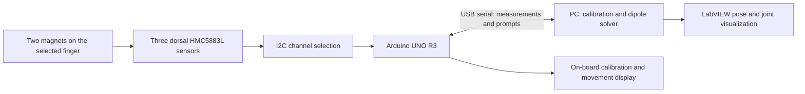

# Magnetic Positioning Rehabilitation Glove Based on Arduino and LabVIEW

**An undergraduate magnetic tracking project (June–September 2022), being reconstructed as a reproducible research demo.**

Arduino UNO R3 · Three HMC5883L magnetometers · Two removable magnets · LabVIEW · Magnetic dipole localization

## Overview

This project reconstructs an undergraduate magnetic tracking prototype as a **single-finger, sequential assessment demo**. A fabric glove carries two 3D-printed magnet sockets per finger and a larger dorsal mount for the acquisition board. Only the selected finger contains magnets during a measurement; the other sockets remain empty.

The proposed acquisition board combines an Arduino UNO R3, three HMC5883L sensors, and a display for calibration and movement prompts. Nine magnetic-field components are streamed to the PC, where a magnetic dipole model supports constrained two-magnet estimation and LabVIEW visualization. Target outputs are MCP/PIP flexion for the four fingers and MCP/IP flexion for the thumb.

This modular architecture is the **current reconstruction design**, not a claim that all of these features were validated in 2022.
The original project received a **Guangdong provincial second prize** in **中国大学生机械工程创新创意大赛——2022“明石杯”微纳传感技术与智能应用大赛**, as confirmed by the project owner. The same competition title appears in the June 26, 2022 feasibility report. The Chinese title is retained to avoid inventing an official English translation; an award certificate is not yet included in this repository.

**Current release: documentation only.** This repository does not yet contain runnable firmware, LabVIEW VIs, datasets, or a reconstructed demo. Historical prototype work and planned reconstruction are distinguished below.

## Original prototype and evidence

| Item | What is currently supported |
| --- | --- |
| Project period | June–September 2022, supplied by the project owner |
| Hardware and software | Arduino UNO, HMC5883L array, serial communication, and LabVIEW visualization described in the original report |
| Historical sensor count | Five sensors recalled by the owner; the current reconstruction uses three |
| Bench experiment | The report describes a **two-magnet, 4-DoF experiment**; original code and raw measurements have not yet been recovered |
| Nine-magnet glove | Proposed extension in the report; simultaneous nine-magnet tracking has not been established by the materials reviewed |
| Magnet dimensions | Four cylindrical magnets, Ø8 × 6 mm; five, Ø12 × 3 mm, according to the report |
| Finger joint angles | Intended application; no validated MCP/PIP angle error measurements are currently available |
| Accuracy and speed | No reproducible positioning error, angle error, or end-to-end update-rate benchmark is available |

The report names the team as **毫末生花** and the team leader as **赵勃宇 (Zhao Boyu)**. Individual implementation roles and further contributor credits will be added when confirmed.

## Current demo architecture

The glove has ten sockets, but **only two magnets are installed at a time**. Remove unused magnets from the measurement workspace. The dorsal board establishes the measurement frame only insofar as its mount remains stable relative to the hand.

Recommended mounting for the reconstruction, to be confirmed mechanically:

| Finger | Magnet sockets | Intended angles |
| --- | --- | --- |
| Index, middle, ring, little | Proximal and middle phalanges | MCP and PIP flexion |
| Thumb | Proximal and distal phalanges | MCP and IP flexion |

The thumb has an IP joint, rather than a DIP joint; see [The Hand Society's joint anatomy reference](https://assh.my.site.com/handcare/safety/joints). Thumb MCP estimation additionally needs a calibrated first-metacarpal reference: thumb CMC motion changes this reference relative to the dorsal board. The initial demo should constrain CMC motion or add a means of measuring it.

Key the removable sockets to reproduce insertion depth, magnet polarity, and magnetic-axis orientation. Fabric stretch, socket motion, and board slip must be measured; a fabric glove is not automatically a rigid skeletal reference.

The UNO handles acquisition, display prompts, and serial communication; the PC performs optimization. This division suits the [UNO R3 hardware](https://store.arduino.cc/products/arduino-uno-rev3). Sensor spacing, channel selection, display interface, and protocol remain design decisions.

## Magnetic dipole model

For sensor position $\mathbf{s}_i$, magnet position $\mathbf{p}_j$, and magnetic moment $\mathbf{m}_j$, let $\mathbf{r}_{ij}=\mathbf{s}_i-\mathbf{p}_j$. In air, the predicted field is

$$
\mathbf{B}_i = \mathbf{b}_i + \frac{\mu_0}{4\pi}\sum_{j=1}^{2}\left[\frac{3\mathbf{r}_{ij}(\mathbf{m}_j^\mathsf{T}\mathbf{r}_{ij})}{\|\mathbf{r}_{ij}\|^5}-\frac{\mathbf{m}_j}{\|\mathbf{r}_{ij}\|^3}\right].
$$

Here $\mathbf{b}_i$ is the background field at sensor $i$. Use meters, A·m², and tesla consistently. Sensor measurements must first be calibrated and expressed in the same coordinate frame. The point-dipole approximation requires sufficient separation relative to magnet size; its error must be checked experimentally at the intended working distances.

The inverse problem estimates magnet states from all measured field vectors jointly. A proposed reconstruction objective is

$$
\hat{\mathbf{x}}_t=\arg\min_{\mathbf{x}}\sum_i\|\mathbf{W}_i^{1/2}(\mathbf{B}^{\mathrm{meas}}_{i,t}-\mathbf{B}^{\mathrm{pred}}_i(\mathbf{x}))\|^2+\lambda\|\mathbf{x}-\mathbf{x}_{t-1}\|_{\mathbf{Q}}^2,
$$

with bounds, calibrated magnetic moment magnitudes, and optional hand kinematic constraints. Temporal regularization is a reconstruction proposal, not a verified feature of the 2022 implementation.

The original report attributes its dipole formulation and particle swarm optimization (PSO) approach to 邱肖肖's thesis *多目标磁定位技术的研究*. The supplied CAJ file has not yet been decoded; the thesis equations, publication details, and algorithm settings have therefore not been independently checked. The vector equation above uses standard dipole notation rather than copying the report's ambiguous equation transcription. Related experimental work is available in [Localization accuracy of multiple magnets in a myokinetic control interface](https://pmc.ncbi.nlm.nih.gov/articles/PMC7921431/).

## Feasibility and limitations

### Nine measurements do not automatically determine two magnet poses

Three triaxial sensors provide nine scalar readings per frame. A free dipole of known moment magnitude has three position and two magnetic-axis direction parameters, making **ten unknowns for two free magnets**. Rotation about the magnetic axis is unobservable in the ideal model; see [magnetic object tracking research](https://user.it.uu.se/~thosc112/team/wahlstrom2015phd.pdf).

An eight-parameter model passes the basic counting test only if the **four degrees of freedom per magnet are explicitly constrained**. One possible definition is `(x, y, z, theta)`, with the magnetic axis restricted to a known plane. This is a candidate model, not a recovered definition of the original algorithm. If both position and axis are restricted to a known plane, the count is instead three per magnet. Extra unknown magnetic strengths, offsets, or mounting parameters must not be silently omitted.

For the assessment demo, the preferred starting point is a calibrated finger model with two flexion angles; magnet positions and axes follow from segment geometry and mounting transforms. Under fixed palm reference, fixed abduction, and known calibration, this reduces the inverse problem to two angle parameters. It is a proposed reconstruction method. It still requires a full-rank, sufficiently well-conditioned measurement Jacobian across the intended movement range; counting measurements alone does not prove unique or accurate recovery.

Fit both magnets jointly. Their superposed fields remain coupled even when only two magnets are installed. Use anatomical identity constraints, bounded angles, and initialization; report ambiguous or failed estimates rather than displaying them as valid tracking. Temporal smoothing cannot restore missing observability.

### Acquisition and a moving dorsal reference

HMC5883L sensors share I²C address `0x1E`, so three devices require multiplexing or other bus isolation. Continuous output reaches 75 Hz, but end-to-end rate depends on sensor timing, sequential reads, serial transfer, optimization, and display handling. Check saturation and module voltage compatibility against the [Honeywell datasheet](https://www.acmesystems.it/download/datasheets/HMC5883L.pdf).

Calibrate sensor axes, scale and offsets into a common board frame. A dorsal board rotates with the hand, so the Earth's field in its coordinates changes: one background subtraction does not cover arbitrary hand motion. For the initial demo, support the hand in a fixed orientation and keep the board stable. Unrestricted hand motion needs additional orientation/background handling and a renewed observability analysis. The display, power wiring, and changing electrical loads should be evaluated as potential magnetic disturbances in their actual operating states.

### Joint-angle interpretation

For the four fingers, calibrate the proximal segment relative to the palm reference for MCP flexion, and the middle segment relative to the proximal for PIP flexion. A magnetic axis is not a full segment orientation: flexion-plane and mounting assumptions are required. Middle/distal placement instead directly supports a DIP-related measurement, so the sockets should not simply inherit the earlier nine-magnet layout.

For the thumb, proximal/distal placement targets IP motion; MCP motion additionally requires the first-metacarpal reference described above. No clinical effectiveness, joint-angle accuracy, or unrestricted hand-motion tracking has yet been established.

## Guided measurement workflow (planned)

1. Select a finger in the PC interface; show the selected finger on the board display.
2. With magnets removed, acquire background readings in the supported measurement posture, with electronics operating normally.
3. Insert the two identified magnets into that finger's keyed sockets. Confirm the correct polarity and fit; keep other magnets away.
4. Record the reference pose and prescribed calibration movements. Use independently measured geometry and calibration fixtures where necessary; one neutral pose cannot determine every model parameter.
5. Prompt slow flexion/extension. Stream timestamped readings and display estimated angles, trajectories, fit residuals, and invalid-tracking status in LabVIEW.
6. Save the session with finger ID and calibration ID. Remove the magnets and repeat for the next finger, checking background and fit after repositioning.

The display provides guidance; it is not evidence that the physical action or calibration succeeded. The acquisition loop should remain responsive while prompts change.

## Reconstruction roadmap

- [x] Document the historical architecture and separate evidence from planned capabilities.
- [ ] Recover the original Arduino sketch, LabVIEW VIs, sensor layout, and experiment records.
- [ ] Build a hardware-free single-magnet simulator with ground-truth positions and magnetic-axis directions.
- [ ] Extend to two magnets and benchmark noise sensitivity, initialization, and identity swaps.
- [ ] Reproduce acquisition and replay recorded sensor data through LabVIEW.
- [ ] Design keyed sockets and a repeatable dorsal board mount.
- [ ] Specify and test a constrained two-magnet model for three sensors.
- [ ] Calibrate finger geometry, thumb reference constraints, and insertion repeatability.
- [ ] Implement display prompts and sequential five-finger sessions.
- [ ] Publish a short demo video, example data, setup instructions, and measured results.

Simulation outputs and recorded hardware measurements will be labeled separately. Animation driven by known simulated angles will be distinguished from angles recovered from magnetic measurements.

## Validation plan

Report position error against a measured fixture or independent reference, magnetic-axis angular error, joint-angle error against an independent angle reference, identity-swap rate, tracking failures, and end-to-end latency. Record sensor geometry, calibration, magnet dimensions, working distance, solver settings, and computer specifications. Use held-out trajectories and show failure cases as well as successful sequences. Include repeated magnet insertion, repeated glove donning, finger-specific workspace coverage, thumb CMC leakage, and display-state changes.

For synthetic data, retain ground truth and disclose that the measurements are simulated. Vary noise, background offsets, magnet spacing, and model mismatch; fitting data generated by the same ideal model is not hardware validation.

## Repository contents

- `README.md` — project overview, model, evidence boundaries, and roadmap.
- `docs/feasibility.zh-CN.md` — Chinese feasibility analysis and reconstruction plan.

## Source materials and attribution

1. Project feasibility report, *基于Arduino与LabVIEW的磁定位康复手套*, dated June 26, 2022; supplied privately by the project owner.
2. 邱肖肖, *多目标磁定位技术的研究*; supplied as CAJ. Bibliographic details and direct verification are pending.
3. [Honeywell HMC5883L datasheet](https://www.acmesystems.it/download/datasheets/HMC5883L.pdf).
4. [Arduino UNO R3 documentation](https://docs.arduino.cc/hardware/uno-rev3/).
5. [Localization accuracy of multiple magnets in a myokinetic control interface](https://pmc.ncbi.nlm.nih.gov/articles/PMC7921431/).
6. [Tracking Position and Orientation of Magnetic Objects Using Magnetometer Networks](https://user.it.uu.se/~thosc112/team/wahlstrom2015phd.pdf).

The original report and thesis are not redistributed here. No software license has been selected yet; public visibility alone does not grant an open-source license.
